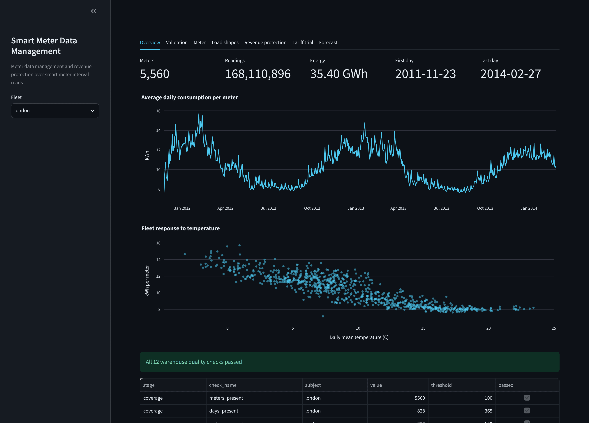
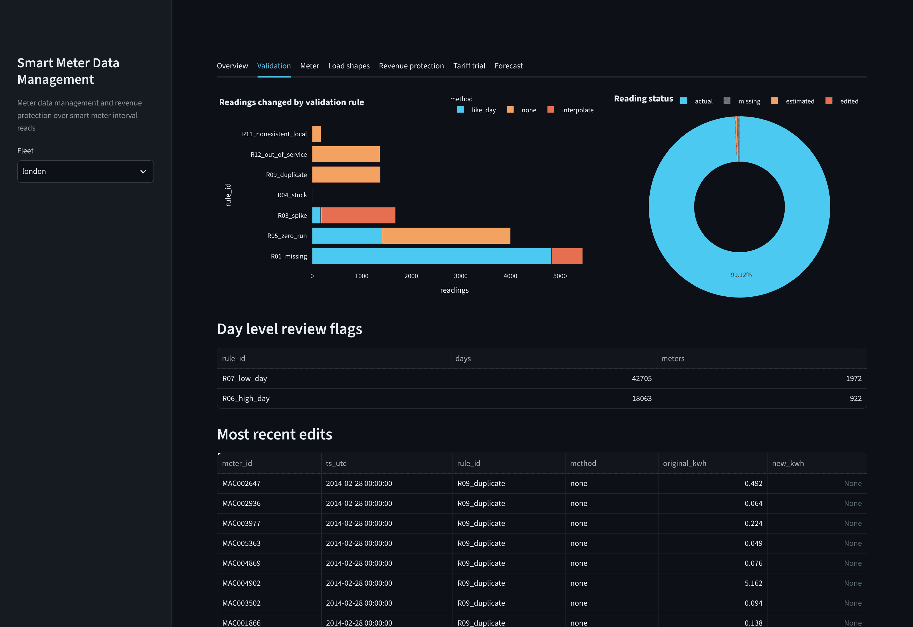
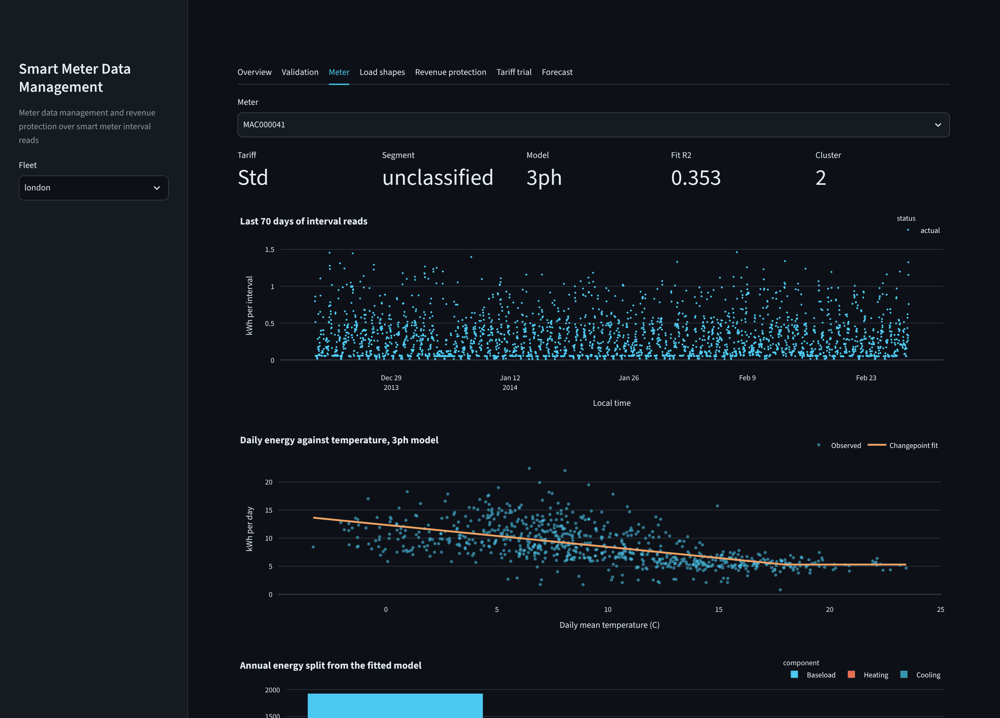
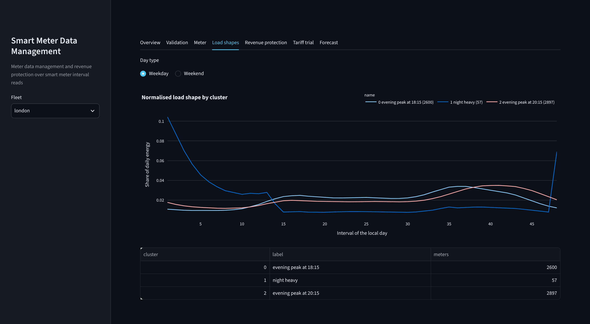
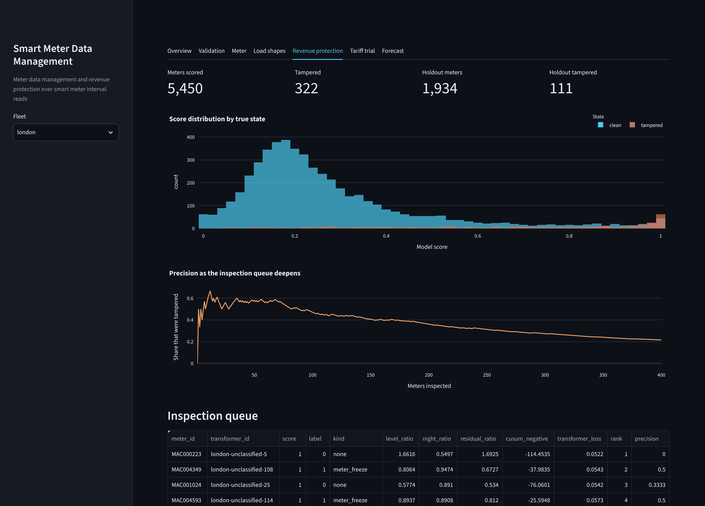
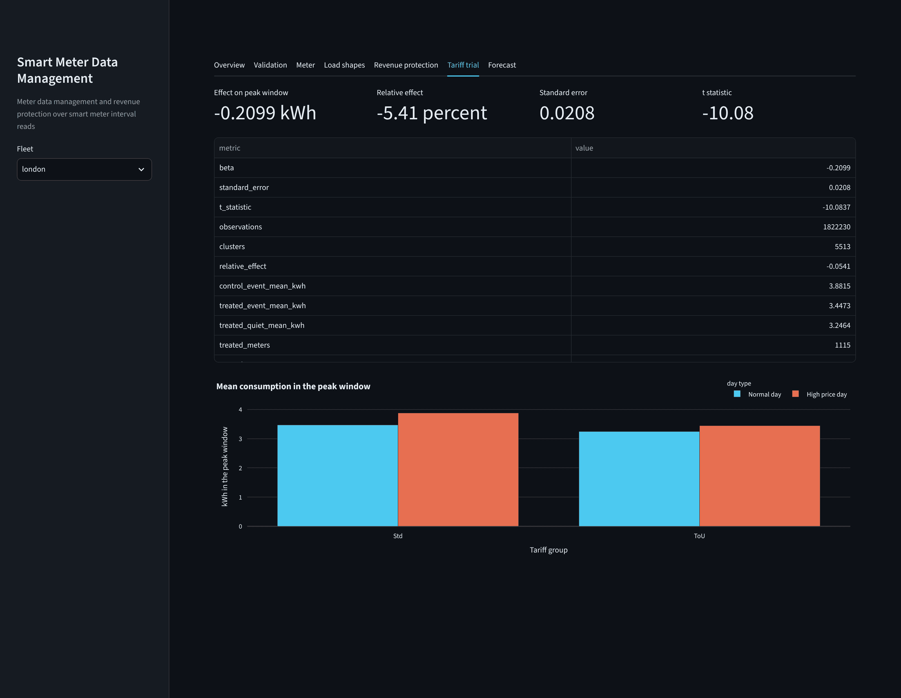
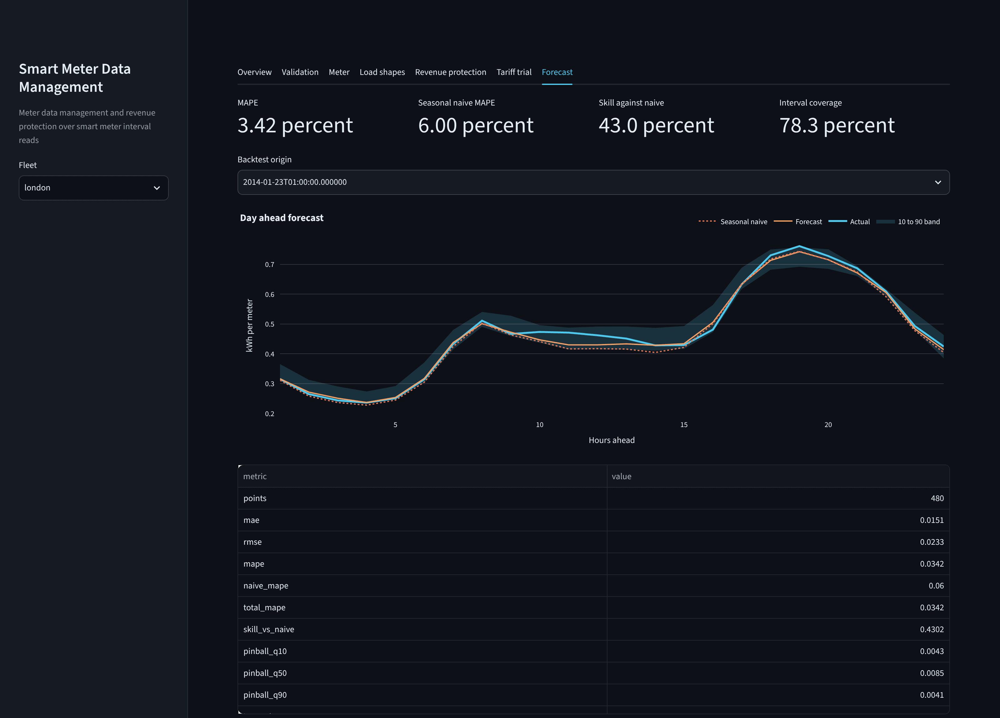

# smart-meter-data-management-platform

Smart meters send a reading every 15 or 30 minutes. A lot of those readings are not usable as they arrive. Some are
missing, some sit frozen at the same number for days, some are spikes, and twice a year the local clock either loses an
hour or repeats one. Utilities have to fix all of that before anyone gets a bill, and they also have to find the meters
that quietly start reporting less energy than the customer actually used.

meterdm does both. It runs the validation, estimation and editing steps that a meter data management system runs, then
uses the cleaned series for weather models, load shape clustering, revenue protection, tariff evaluation and day ahead
forecasting. The last full run processed 209,966,482 interval readings from 5,930 meters of real public data.

Live demo: https://adwitiyashukla-smart-meter-data-management-platform.hf.space/

## What it does

1. Downloads two public smart meter datasets, a tariff schedule and hourly weather, with resume, retries and a check
   that the server returned a data file rather than an error page.
2. Parses them into partitioned parquet without changing a value.
3. Runs twelve validation rules and two estimation methods, writing every change to an audit table. The raw layer is
   never modified.
4. Builds a DuckDB star schema with twelve quality checks stored alongside the facts.
5. Measures the estimators by hiding readings that are known to be good and asking the pipeline to fill them back in.
6. Fits a changepoint degree day model per meter and splits each meter into baseload, heating and cooling.
7. Clusters normalised daily load shapes with k-means written from scratch.
8. Scores every meter for non technical loss, using injected tampering as ground truth so precision and recall are
   measured rather than asserted.
9. Estimates the effect of a dynamic time of use tariff with a two way fixed effects difference in differences.
10. Forecasts the next 24 hours with a rolling origin backtest and conformal prediction intervals.

## Data

| Fleet | Source | Meters | Interval | Readings | Span |
| --- | --- | --- | --- | --- | --- |
| london | Low Carbon London smart meter trial, London Datastore | 5,560 | 30 min | 168,110,896 | 2011-11-23 to 2014-02-27 |
| portugal | ElectricityLoadDiagrams 2011-2014, UCI | 370 | 15 min | 41,855,586 | 2011-01-01 to 2014-12-31 |
| weather | Open-Meteo hourly archive | 2 sites | 60 min | 72,960 | 2011-01-01 to 2015-02-28 |

The London feed carries 5,566 meter ids. Six of them never report a reading above zero and are dropped as out of
service, which is why the fleet is 5,560. Bank holidays for both countries are vendored in `refdata/` because the load
on a holiday does not look like the load on an ordinary Tuesday.

Both datasets carry real time handling problems and the pipeline reproduces them rather than papering over them. The
London file is in local wall clock time, so on the October transition day a meter has 50 half hour readings and two of
the timestamps repeat. The Portuguese file always has 96 rows per day, so on the March transition day the rows between
01:00 and 02:00 are zero for every client and in October they hold two hours of energy. In the real files that comes to
115,453 duplicate readings and 13,182 timestamps that never existed in local time. Both are handled explicitly and both
are covered by tests.

## How the pipeline runs

    raw csv  ->  bronze parquet  ->  VEE  ->  silver parquet  ->  DuckDB gold  ->  six analytics stages

Everything is driven by `config.toml`. Every tunable lives there and is validated on load, so a bad value fails with the
key name instead of a stack trace three stages later.

The VEE stage is sharded by meter. Meters do not interact, so the work is split into 112 batches and each batch is a
bounded piece of work inside DuckDB. That is what keeps the stage inside a 3 GB memory limit while it handles 168
million rows.

## Results

Everything below is measured on the real data by the run whose logs produced these numbers. Nothing here is synthetic.

### Validation, estimation and editing

Every reading on the expected local grid ends in exactly one of four states.

| Status | london | portugal |
| --- | --- | --- |
| Actual | 167,246,935 | 41,420,659 |
| Estimated | 417,934 | 4,804 |
| Edited after a rule fired | 235,689 | 326,222 |
| Left missing | 210,338 | 103,901 |
| **Total** | **168,110,896** | **41,855,586** |

412,942 London rows and 4,824 Portuguese rows did not exist in the source files at all. The engine detects the gap from
the timestamp sequence, generates the slot and then estimates it. Rows that cannot belong to the series are rejected
before silver and recorded separately.

| Rejected before silver | london | portugal |
| --- | --- | --- |
| Duplicate readings | 115,453 | 0 |
| Timestamps that do not exist locally | 13,182 | 5,920 |
| Outside the meter service window | 105,885 | 10,038,038 |

The Portuguese number is the interesting one. That file pads every client back to 2011-01-01 with zeros whether or not
the meter existed yet, so 10 million readings are not gaps in a live series, they are the time before installation.
Counting them as missing data would have put a quarter of the fleet in the missing bucket. Trimming each meter to its
own service window brings the Portuguese fleet to 99.0 percent usable readings.

Rule hits, counted on the readings each rule changed:

| Rule | london | portugal |
| --- | --- | --- |
| R01 missing | 418,469 | 4,824 |
| R03 spike against the meter's own profile | 128,508 | 19,595 |
| R05 zero run | 316,500 | 317,203 |
| R04 stuck register | 484 | 93,305 |

Day level review flags are kept apart from interval edits, because a day that is simply unusual is a case for a human
rather than a value to overwrite. The London fleet produced 60,768 of them: 42,705 low days across 1,972 meters and
18,063 high days across 922 meters.

### Are the estimates any good

The estimator is scored against readings that were known to be good. The holdout stage takes eight meter batches per
fleet, hides blocks of readings from one to 96 intervals long, re-runs the same two estimation methods that the pipeline
uses, and compares the result with the value it hid.

| Check | london | portugal |
| --- | --- | --- |
| Meters | 361 | 370 |
| Readings hidden and re-estimated | 83,606 | 86,527 |
| Meter days checked | 5,196 | 4,526 |
| Median error on a day total | 3.66 percent | 0.53 percent |
| Mean error on a day total | 14.11 percent | 3.53 percent |
| Mean absolute error per interval | 0.106 kWh | 22.43 kWh |
| The same, against the mean reading | 48.7 percent | 15.3 percent |

A single household half hour is close to unpredictable, and 48.7 percent of a 0.217 kWh mean reading says so. The day
total is what a bill is built from, and there the median miss is under four percent in London and about half a percent
in Portugal. The split by method is worth reading too: short gaps filled by interpolation land at 0.091 kWh in London
and 7.8 kWh in Portugal, while long gaps filled from a matching day land at 0.107 and 23.4. Gap length, not fleet, is
what decides the error.

### Changepoint models

One ASHRAE style changepoint model per meter, chosen between six shapes by exact grid search and AIC.

| Measure | london | portugal |
| --- | --- | --- |
| Meters fitted | 5,550 | 370 |
| Most common shape | heating only, 2,136 | four parameter, 131 |
| Next most common | straight line, 2,100 | cooling only, 118 |
| Mean R2 | 0.171 | 0.365 |
| Median CV(RMSE) | 0.291 | 0.110 |
| Fits accepted | 2,805 | 327 |
| Median heating changepoint | 14.3 C | 15.7 C |
| Heating share of modelled energy | 23.5 percent | 0.7 percent |
| Cooling share of modelled energy | 0.8 percent | 16.0 percent |

Two fleets, two different buildings. London households are heating driven and barely cool at all, and the fits are loose
because occupancy moves a house more than weather does. The Portuguese clients are commercial and industrial, so their
load tracks temperature far more closely and the models fit three times better, and the energy that weather explains is
cooling rather than heating. Reporting these two fleets as one number hides both facts, so the summary keeps them apart.

### Load shapes

k-means written from scratch, checked against scikit-learn in the tests, with k chosen by silhouette over a scan from 3
to 10.

| Fleet | Meters | k | Silhouette | Clusters |
| --- | --- | --- | --- | --- |
| london | 5,554 | 3 | 0.141 | evening peak at 20:15 (2,897), evening peak at 18:15 (2,600), night heavy (57) |
| portugal | 370 | 5 | 0.415 | flat with a midday lean (194), evening peak (87), flat with a night lean (36), morning and evening (33), daytime (20) |

The silhouette scores are the finding. Household load shapes are a continuum, so 5,554 homes split into little more than
an early evening peak and a late evening peak, and the separation is weak. The 370 commercial clients separate three
times better into shapes that match how a business actually runs.

### Revenue protection

Tampering is injected into a share of meters as one of four patterns: a constant bypass, a night only bypass, a frozen
register and a slow drift. Meters are split into a training half and a held out half, and the model is scored on the
held out half only.

| Metric | london | portugal |
| --- | --- | --- |
| Meters scored | 5,450 | 369 |
| Tampered | 322 | 24 |
| ROC AUC | 0.869 | 0.993 |
| Average precision | 0.400 | 0.934 |
| Unsupervised rank baseline AUC | 0.789 | 0.763 |
| Precision at 50 inspections | 0.58 | 0.14 |
| Precision at 100 inspections | 0.47 | 0.04 |

Recall inside the top scoring decile, by what was done to the meter:

| Tamper type | london | portugal |
| --- | --- | --- |
| Frozen register | 1.00 | 1.00 |
| Constant bypass | 0.88 | 1.00 |
| Night only bypass | 0.61 | 1.00 |
| Slow drift | 0.32 | 1.00 |

A slow drift is the one that gets away, which is what you would expect: a meter losing a few percent a month looks like
a household that bought a more efficient fridge. The Portuguese fleet is easier because a commercial load is regular
enough that any tampering stands out, but with only 24 tampered clients the precision at a fixed inspection count is
low, since the queue runs out of real cases long before it runs out of slots.

### Dynamic time of use tariff

The London trial priced some half hours High, Normal or Low, signalled a day ahead. The pipeline reads the published
tariff file, finds the half hour block that was priced High on more days than any other, and uses that as the peak
window: twelve half hours from 16:30 to 22:30. 31 days priced that entire block High. Consumption in the same clock
window on the other 313 days is the comparison.

| Measure | Value |
| --- | --- |
| Treated meters | 1,115 |
| Control meters | 4,398 |
| Meter days | 1,822,230 |
| Effect on peak window consumption | -0.2099 kWh |
| Relative to the control group | -5.41 percent |
| Standard error, clustered on the meter | 0.0208 |
| t statistic | -10.08 |
| Placebo draws on non event days | 200 |
| Placebo draws at least as extreme | 0 |

Households on the dynamic tariff used 5.41 percent less in the evening peak on high price days than the control group
did. The fixed effects are absorbed by alternating projection rather than by building dummy columns, and the tests check
that result against statsmodels with explicit meter and day dummies on a smaller panel.

### Day ahead forecast

20 rolling origins a week apart, 24 hour horizon, 480 forecast points per fleet.

| Fleet | MAPE | Seasonal naive MAPE | Skill | Interval coverage | Coverage before calibration |
| --- | --- | --- | --- | --- | --- |
| london | 3.42 percent | 6.00 percent | 43.0 percent | 78.3 percent | 60.0 percent |
| portugal | 3.11 percent | 6.11 percent | 49.1 percent | 77.5 percent | 46.5 percent |

The quantile models on their own are far too confident. An interval sold as 80 percent covers 60 percent of London
points and 47 percent of Portuguese ones. Split conformal calibration on a held out slice of the training window widens
it to 78.3 and 77.5 against a nominal 80, which is an interval that means what it says.

### Timings

Measured on a Windows laptop with `duckdb.threads` at 4 and the DuckDB memory limit at 3 GB.

| Stage | Wall time | Output |
| --- | --- | --- |
| Bronze | 432 s | 506 MB parquet |
| VEE | 4,649 s | 1.16 GB parquet |
| Gold | 85 s | 750 MB DuckDB |
| Holdout | 289 s | |
| Changepoint | 35 s | |
| Load shape clustering | 180 s | |
| Revenue protection | 75 s | |
| Tariff trial | 375 s | |
| Day ahead forecast | 1,000 s | |

That is a little under two hours end to end over 9.6 GB of raw files, not counting the downloads. All 12 warehouse
quality checks pass. 176 tests.

## Running it

Install and run a small end to end pass, which builds a synthetic replica, runs the whole pipeline and writes a report:

    pip install -e ".[dev]"
    python -m meterdm.cli --profile sample run --synthetic
    python -m meterdm.cli --profile sample report

To run against the real data, check the sources first, then fetch and run:

    python -m meterdm.cli probe
    python -m meterdm.cli fetch
    python -m meterdm.cli run

If a download URL has moved, fetch the archive yourself and point the extractor at it:

    python -m meterdm.cli extract --london Power-Networks-LCL-June2015.zip

Open the app:

    streamlit run app.py

Or the API:

    uvicorn meterdm.api:app --reload

Set `duckdb.threads` in `config.toml` to the number of cores you have. The VEE stage scales almost linearly with it.

## Repo layout

| Path | What is in it |
| --- | --- |
| `meterdm/` | The package: ingest, VEE, warehouse, and the six analytics stages |
| `app.py` | Streamlit app |
| `pipeline.py` | Dagster assets for the same stages |
| `tools/scan_comments.py` | Checks the tracked files for comments, docstrings and non ascii bytes |
| `refdata/` | Bank holidays for the UK and Portugal |
| `config.toml` | Every tunable, validated on load |

CI runs ruff, the source scan, the test suite on Python 3.11 and 3.12, a synthetic end to end smoke run that also builds
and opens the Space bundle, and a probe that checks the public sources are still where the config says they are.

## Sources

- Low Carbon London household smart meter trial, UK Power Networks, published on the London Datastore under the Open
  Government Licence.
- ElectricityLoadDiagrams20112014, Trindade, A., UCI Machine Learning Repository.
- Open-Meteo historical weather archive.
- UK bank holidays, GOV.UK. Portuguese national holidays, Diario da Republica.
- The changepoint models follow the shapes described in ASHRAE Guideline 14 for whole building energy models.
